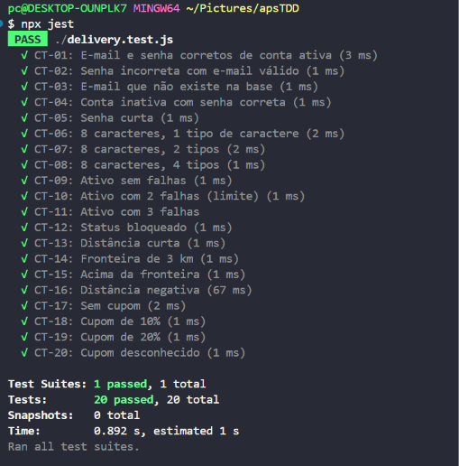
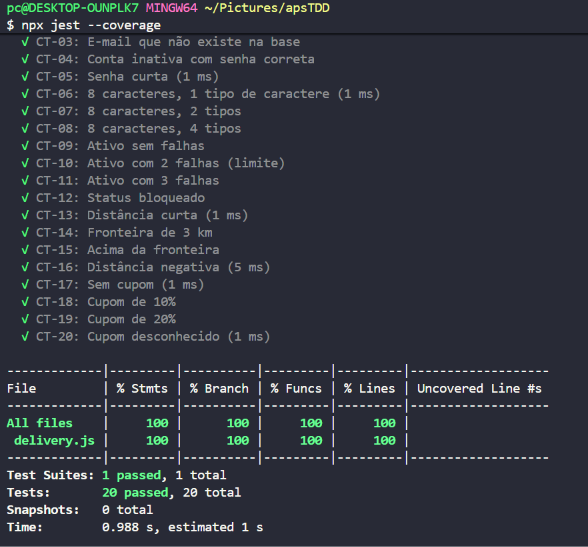

# DeliveryExpress

Projeto para entrega da APS de TDD com testes automatizados em Jest.

## grupo1000
Marcelino Rodrigues do Nascimento

## Como executar

1. Instale as dependências:
   ```bash
   npm install
   ```
2. Execute os testes:
   ```bash
   npm test -- --runInBand
   ```

## Funcionalidades implementadas

- Autenticação de usuários
- Cálculo de força de senha
- Verificação de permissão de login
- Cálculo de frete
- Aplicação de cupons

## Estrutura do projeto

- `delivery.js` — implementação das funções
- `tests/delivery.test.js` — suíte de testes
- `assets/` — imagens e recursos visuais do projeto

## Testes passados



## Coverage

